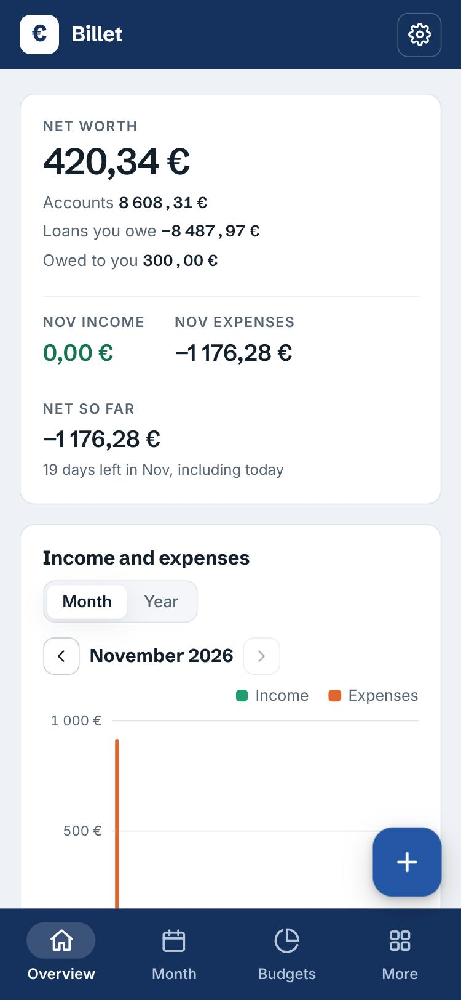
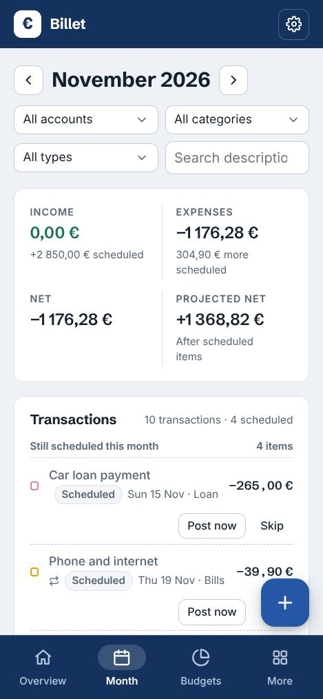
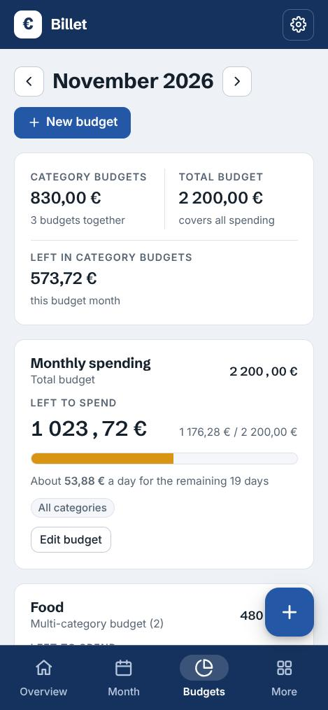
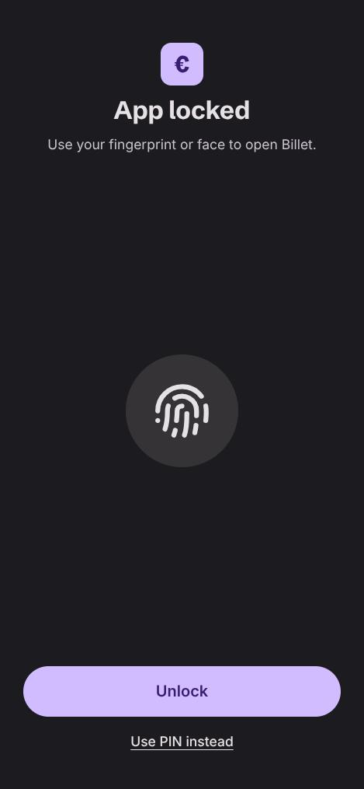

# Billet

A simple budget app for your monthly income and expenses, in euros. Billet works fully offline: everything you
enter stays on your phone, and the app has no internet access at all.

<p>
  
  
  
  
</p>

**[Download the latest Billet.apk](https://github.com/valtsu081/billet/releases/latest)** (Android 8.0 or newer)

## Features

- **Accounts:** several accounts (bank, savings, cash, card), with balances you can hide.
- **Categories you make yourself**, with a page for each showing its spending month by month.
- **Month view** of every transaction, with filters and search.
- **Budgets:** for all spending or chosen categories and accounts, with how much is left per day.
  The budget month can start on any day, for example your payday.
- **Recurring payments** that remind you when they're due, or post themselves.
- **Loans**, including Euribor + margin interest.
- **Income and expenses chart** by month or year.
- **CSV import and export**, including files from Finnish banks and Ivy Wallet, plus full backups.
- **Looks:** light and dark mode, five colour themes, and Material You colours from your wallpaper (Android 12+).
- **App lock (optional):** unlock with your phone's own fingerprint or face unlock, or a PIN.

## Install

1. Download `Billet.apk` from the [latest release](https://github.com/valtsu081/billet/releases/latest) on your phone.
2. Open it. If Android asks, allow your browser or Files app to **install unknown apps**, then tap **Install**.
   Play Protect may say the app is from an unknown developer; choose **Install anyway**.

**Updating:** download the newer `Billet.apk` and install it over the old one. Your data stays.

## Your data

- Billet saves everything **only on your phone**, inside the app. It never sends anything anywhere:
  the app doesn't even have the internet permission.
- It's left out of Google's cloud backups. Use **Settings → Download backup** now and then, because
  uninstalling the app deletes its data.
- The app lock stores only a salted hash of your PIN. Fingerprint and face checks are done by Android itself;
  Billet only gets a yes or no.

## Build it yourself

Billet is one web page (`web/billet.html`) inside a small Android wrapper. It builds without Android Studio or Gradle,
on Linux:

```bash
./setup-toolchain.sh   # once: downloads a JDK and the Android SDK build tools (about 550 MB) into ~/.local/share/billet-android
./build.sh             # writes Billet.apk
```

`build.sh` signs the app with `signing/billet.jks`, and makes a new key there the first time if there isn't one.
That key isn't in this repository, so your own build has a different signature from the official release:
Android won't install it over the official app (or the other way round) without uninstalling first.

When making an update, raise `VERSION_CODE` in `build.sh` and `APP_VERSION` in `web/billet.html`.

| Path | What it is |
|---|---|
| `web/billet.html` | The whole app: interface, data model, budgets, import and export |
| `src/…/MainActivity.java` | The Android wrapper: web view, file picker and saving, bar colours, fingerprint and face unlock |
| `AndroidManifest.xml`, `res/` | App name, icon, theme and permissions |
| `build.sh`, `setup-toolchain.sh`, `tools/` | The build: bundles the fonts for offline use, compiles, signs |

## Licence

Billet is under the [MIT License](LICENSE). The fonts and some icons have their own licences; see
[THIRD_PARTY_NOTICES.md](THIRD_PARTY_NOTICES.md).
